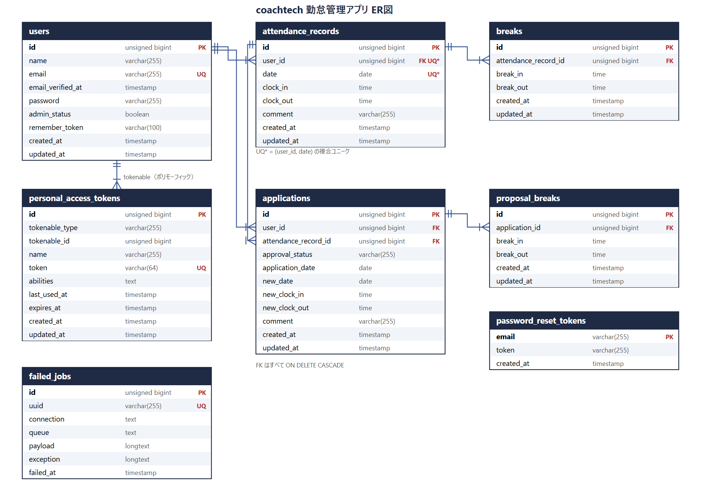

# coachtech 勤怠管理アプリ

## 環境構築

Docker（Docker Desktop）が起動している状態で、以下を順に実行します。Windows の場合は WSL2（Ubuntu）のターミナルで実行してください。

### 1. リポジトリの取得

```bash
git clone https://github.com/hkentikushi-a11y/coachtech-attendance.git
cd coachtech-attendance
```

### 2. 依存パッケージのインストール（vendor の作成）

```bash
docker run --rm \
  -u "$(id -u):$(id -g)" \
  -v "$(pwd):/var/www/html" \
  -w /var/www/html \
  -e COMPOSER_CACHE_DIR=/tmp/composer_cache \
  laravelsail/php82-composer:latest \
  composer install
```

### 3. 環境変数ファイルの作成

```bash
cp .env.example .env
```

### 4. Docker のビルドと起動

```bash
./vendor/bin/sail up -d
```

初回はアプリのコンテナ（PHP 8.2）のイメージをビルドするため、数分〜20分ほどかかります。

### 5. アプリケーションキーの生成、マイグレーション、シーディング

```bash
./vendor/bin/sail artisan key:generate
./vendor/bin/sail artisan migrate --seed
```

### 6. フロントエンド（Vite）

```bash
./vendor/bin/sail npm install
./vendor/bin/sail npm run dev
```

> エイリアスを設定すると `sail` だけで実行できます：`alias sail='[ -f sail ] && bash sail || bash vendor/bin/sail'`

### 7. テスト（PHPUnit）

```bash
./vendor/bin/sail artisan test
```

テストはテスト用データベース `testing`（Sail の MySQL コンテナの初回起動時に自動で作成されます）を使うため、開発用のデータには影響しません。

## 使用技術（実行環境）

- PHP 8.2
- Laravel 10.x
- MySQL 8.4
- Laravel Sail（Docker）
- Laravel Fortify（認証）
- Laravel Sanctum（公開 API のトークン認証）
- Vite（フロントエンドのビルド）
- Mailpit（開発用メールサーバー）
- phpMyAdmin

## ER図



## URL

- 開発環境：http://localhost/
- 会員登録：http://localhost/register
- ログイン（一般ユーザー）：http://localhost/login
- ログイン（管理者）：http://localhost/admin/login
- phpMyAdmin：http://localhost:8080/
- Mailpit：http://localhost:8025/

## ログイン情報

シーディング（`migrate --seed`）で以下のユーザーが作成されます。

| 種別 | 名前 | メールアドレス | パスワード |
|---|---|---|---|
| 一般ユーザー | 山田 太郎 | user1@example.com | password |
| 一般ユーザー | 佐藤 花子 | user2@example.com | password |
| 管理者 | 管理者 | user3@example.com | password |

いずれもメール認証済みです。

### ダミーデータ

- **山田 太郎（user1）**：マイ勤怠レポートの検証用データ（過去5ヶ月は各月の最初の平日15日を 9:00〜18:00、当月は平日17日を通常・残業・遅刻・早退・長時間で作成）。`/attendance/report` で総労働時間 744時間・総残業時間 10時間・平均 8時間5分・遅刻2回・早退1回・長時間労働1日になります
- **佐藤 花子（user2）**：3ヶ月前の月初から昨日までの平日の勤怠と、修正申請（承認済み1件・承認待ち1件）
- シーディングを実行した日（今日）の勤怠は作成しないため、どのユーザーでもすぐに打刻を試せます

### メール認証の確認方法

新しく会員登録すると認証メールが送信され、メール認証誘導画面が表示されます。「認証はこちらから」で Mailpit（http://localhost:8025/ ）を開き、届いたメールの「メールアドレスを確認する」を押すと認証が完了し、勤怠登録画面に移ります。

## 公開 API（v1）

| メソッド | URI | 認証 | 説明 |
|---|---|---|---|
| GET | /api/v1/attendance-records | 不要 | 勤怠一覧（`user_id`・`date`・`month`で絞り込み、`per_page`（既定 20・最大 100）・`page`でページネーション） |
| GET | /api/v1/attendance-records/{attendanceRecord} | 不要 | 勤怠詳細（ユーザー・休憩・修正申請を含む） |
| POST | /api/v1/attendance-records | Sanctum | 勤怠の登録（認証ユーザーの勤怠として登録） |
| PUT / PATCH | /api/v1/attendance-records/{attendanceRecord} | Sanctum | 勤怠の更新（本人または管理者のみ） |
| DELETE | /api/v1/attendance-records/{attendanceRecord} | Sanctum | 勤怠の削除（本人または管理者のみ） |

書き込み系で使うトークンは、次のコマンドで発行できます（例：user1）。

```bash
./vendor/bin/sail artisan tinker --execute="echo App\Models\User::where('email', 'user1@example.com')->first()->createToken('api')->plainTextToken;"
```

発行したトークンは `Authorization: Bearer {トークン}` ヘッダで送ります。

```bash
curl -X POST http://localhost/api/v1/attendance-records \
  -H "Authorization: Bearer {トークン}" -H "Content-Type: application/json" \
  -d '{"date": "2026-12-01", "clock_in": "09:00:00", "clock_out": "18:00:00", "comment": "API から登録"}'
```
